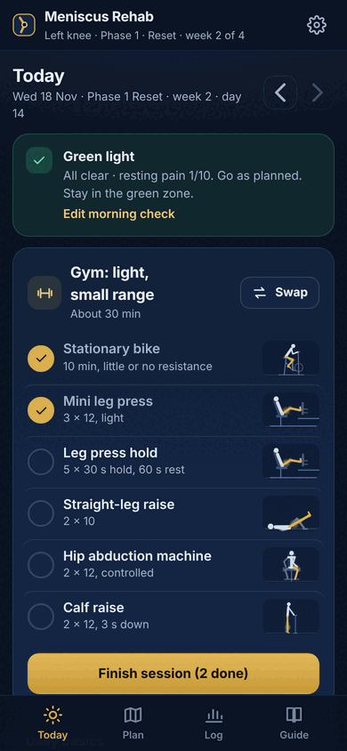
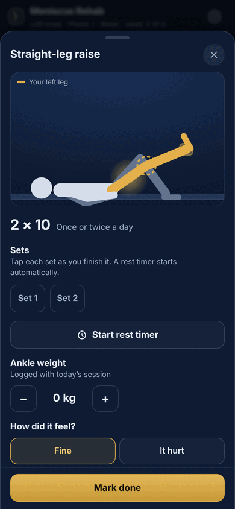
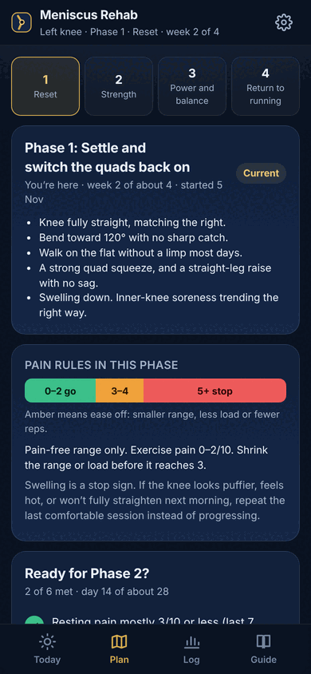
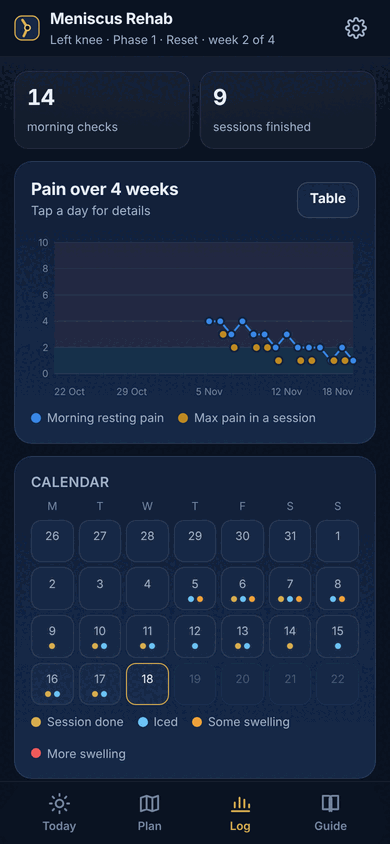

# Meniscus Rehab Tracker

A free, offline web app for working through a staged rehab program after a meniscus tear managed without surgery. It gives you daily sessions with animated exercise demos, pain rules that adjust the day, timers, progress criteria, and a summary you can share with your physio.

There's no account and no server. Your data stays in your browser.

<p>
  
  
  
  
</p>

> **Not medical advice.** This is general education and a personal log. It doesn't diagnose, prescribe or replace an assessment by a GP or physiotherapist. Get the diagnosis confirmed, have a physio review the program before you start, and stop and seek care if a red flag appears.

## Intended use

Self-management and education for a non-serious musculoskeletal condition (a meniscus tear managed without surgery), used alongside care from a GP or physiotherapist. It isn't designed for ligament injuries, a locked knee, or recovery after surgery.

## Features

- **Four phases:** Settle, Strength, Power and balance, Return to running. You move on when you meet criteria, not when a date arrives.
- **Morning check (20 seconds).** Resting pain, swelling, straightening, the next-day comparison, and red flags. Your answers set the day as green, amber (scale back) or red (settle day).
- **45 animated exercise demos** with the injured leg highlighted. Left or right knee.
- **Timers** for holds, stretches, rest between sets, ice (20 minutes on, 20 off) and walk-run intervals, with beeps at every change.
- **Conservative safeguards:**
  - Single-leg loading stays locked until the pain settles.
  - Landing drills need a physio's OK.
  - There's a week-6 review point.
  - Red-flag prompts appear when needed.
- **Pool sessions, an evening stretch routine, a gait self-check and a fortnightly check-in.**
- **Pain chart, calendar and history.** The physio summary comes as copyable text or a PDF.
- **Backup and restore** as a JSON file. Works offline and installs to your home screen (PWA).

## Use it

- **Online:** publish it with GitHub Pages (see below) and open the link on your phone. Use *Add to Home Screen* to install it.
- **Locally:** download `index.html` and open it in a browser. Everything is in that one file. Offline install needs the hosted version.

## Privacy

- No accounts, analytics, cookies or network requests. Nothing you enter leaves your device.
- Entries are kept in your browser's local storage. Clearing your browser data erases them, so use **Back up** regularly.
- The physio summary includes only what you've logged, plus any diagnosis notes you choose to add.

## Publish on GitHub Pages

1. Create a new repository on GitHub, for example `meniscus-rehab-tracker`.
2. Upload every file in this folder, keeping the folder structure (`icons/`, `src/`, `docs/`, `tests/`). You can drag the unzipped folder's contents onto GitHub's *Upload files* page, or use git:
   ```bash
   git init && git add . && git commit -m "Meniscus Rehab Tracker v1.0.0"
   git branch -M main
   git remote add origin https://github.com/airt-gallery/meniscus-rehab-tracker.git
   git push -u origin main
   ```
3. In the repository, go to **Settings → Pages**. Set **Source** to *Deploy from a branch* and **Branch** to `main` with the `/ (root)` folder. Save.
4. After a minute or two, open `https://airt-gallery.github.io/meniscus-rehab-tracker/`.

## Customise the program

The program content lives in `src/data.js`:

- `EX`: exercises, with doses, cues and timers
- `SESS`: sessions
- `WEEK`: weekly patterns
- `PHASES`: pain zones and criteria to move on
- `STAGES`: walk-run stages

`{inj}` and `{oth}` in the text become the injured and other side.

After editing, rebuild the single-file app:

```bash
python3 build.py
```

When you publish an update, bump `VERSION` in `sw.js` so installed copies refresh.

```
index.html            built single-file app (open this)
manifest.webmanifest  install metadata
sw.js                 offline cache
icons/                app icons
src/                  source: fig.js (figure engine), data.js (program), app.js (logic and UI), style.css
build.py              inlines src/ into index.html
tests/                end-to-end checks (Playwright)
docs/screenshots/     README images
```

## Tests

```bash
cd tests
npm install
npx playwright install chromium
npm test
```

The suite runs 20 checks:

- first-run setup and the left/right text
- pain rules
- the single-leg rule
- exercise swaps
- timers
- a full daily log
- backup and restore
- the PDF summary
- opening offline through the service worker

## Evidence base

The program follows a conservative, criteria-based approach drawn from these sources:

- **Trials:** ESCAPE (JAMA 2018; JAMA Netw Open 2022), Kise et al. (BMJ 2016), METEOR (NEJM 2013; 2020), FIDELITY (NEJM 2013, with follow-ups)
- **Consensus statements:**
  - ESSKA 2016 consensus on degenerative meniscus lesions
  - ESSKA-AOSSM-AASPT 2024 consensus on meniscus rehabilitation
  - ESSKA 2019 consensus on traumatic meniscus tears
- **Supporting evidence:**
  - Kurzweil et al. (Arthroscopy 2014), on repairing horizontal tears
  - Messier et al. (Arthritis & Rheumatism 2005), on weight and knee load
  - Falvey et al. (Scand J Med Sci Sports 2010), on stretching the ITB
  - Dubois & Esculier (BJSM 2020), on ice and anti-inflammatories
  - Becker (PM&R 2009), on water depth and weight-bearing
- **Safety advisory:** TGA advisory on turmeric and curcumin (2023)
- **Patient guidance:** NHS leaflets on meniscal tears, GLA:D Australia

## Disclaimer

This software is provided for general information and personal record-keeping only. It isn't a substitute for professional medical advice, diagnosis or treatment. Exercise doses are starting points that need adapting to your symptoms, history and other health conditions. Always seek the advice of a qualified health professional about a medical condition. If you think you have a medical emergency, call 000 in Australia or your local emergency number.

## Licence

MIT. See [LICENSE](LICENSE).
